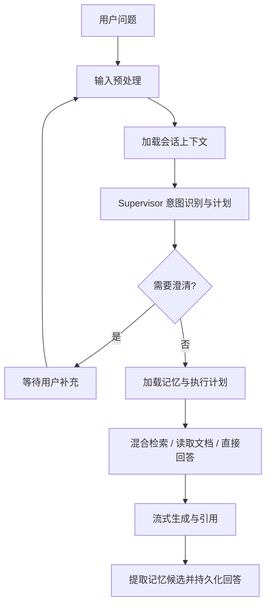

# OwnAgent

OwnAgent 是一个面向个人和团队知识库的对话式 Agent 服务。它以 LangGraph 编排每次 Agent run，支持会话上下文理解、知识检索、文档读取与比较、流式回答、澄清、人工审批和记忆管理。API、Agent、文档导入和记忆处理分别运行，由 PostgreSQL、Redis Streams 和 Outbox 协同完成可靠任务处理。

## Agent 能力

Supervisor 会先结合当前问题、最近会话消息和会话摘要判断意图、改写检索问题并生成受校验的执行计划。当前支持知识问答、文档摘要、文档比较、一般对话和用户偏好更新。涉及模糊指代且上下文不足时，Agent 可以暂停并请求用户澄清；澄清回复会恢复同一个 run。不同问题使用独立 run 和 LangGraph thread，会话关系通过持久化消息和摘要建立。



会话短期上下文默认使用最近 `4000` 个估算 tokens，最新消息优先；会话摘要独立于短期窗口，由 Memory Worker 以“已有摘要 + 新消息”的方式增量合并。长期记忆区分用户级和 Workspace 级，候选经过安全性和敏感度处理；低风险偏好可自动保存，需确认的候选由用户确认或拒绝。记忆用于个性化表达，不作为知识库事实证据。

知识问答默认采用混合召回：向量检索与关键词检索并行执行，合并候选后使用阿里云百炼 DashScope Reranker 重排。检索会遵守 Workspace/文档访问范围，并只使用当前激活的成功文档版本。答案以检索证据为依据并附带文档、版本和片段引用；证据不足时应明确说明。

文档支持 PDF、DOCX、Markdown 和纯文本导入、解析、分块、Embedding、详情预览和分块预览。文档版本追加保存；从详情页替换文件时必须显式指定目标文档。新版本解析成功后才激活，失败时旧版本继续可预览和检索。支持失败重试、重新解析、历史版本预览和手动激活历史版本。

## 架构

| 进程 | 职责 |
| --- | --- |
| API (`src/server.ts`) | 认证、Workspace/API、WebSocket、run 创建与控制、文档和记忆管理 |
| Agent Worker (`src/worker.ts`) | 消费 Agent run 与控制消息，运行 LangGraph，持久化事件并推送实时更新 |
| Document Worker (`src/document-worker.ts`) | 处理文档上传、解析、分块、向量化和版本激活 |
| Memory Worker (`src/memory-worker.ts`) | 更新会话摘要、记忆候选、记忆向量和会话标题 |
| PostgreSQL / Supabase | `ownagent` schema 中保存业务数据、run、事件、Outbox 和 LangGraph checkpoint |
| Redis Streams | 任务短期传输、Consumer Group、Pending 回收和死信队列 |

任务先写入 PostgreSQL 和 Outbox，再由事件驱动的 Dispatcher 发布到 Redis。PostgreSQL 是任务、run、事件和文档版本的持久化事实来源；Redis 不承担长期存储。Agent run 事件可通过 HTTP 按 sequence 补取，也可通过 WebSocket 实时接收。前端 WebSocket 不可用时，可通过事件轮询继续消费已有 run 事件。

数据存放在独立的 `ownagent` schema。后端使用 Supabase service-role 访问数据，并在业务查询中执行 Workspace 和用户权限校验。service-role、JWT、DashScope 和 Storage 密钥不得暴露给浏览器。

## 环境要求

- Node.js 20 或更高版本
- npm
- Docker，用于本地 Redis；也可以连接已有 Redis
- Supabase/PostgreSQL 项目，并启用 Supabase Storage（文档文件存储需要）
- DeepSeek API（Agent Supervisor 和回答生成）
- 可访问的 OpenAI-compatible Embedding 服务
- 阿里云百炼 DashScope Reranker API

## 本地配置与启动

复制环境变量模板：

```powershell
Copy-Item .env.example .env
```

填写至少以下服务配置：

- Supabase：`SUPABASE_URL`、`SUPABASE_SERVICE_ROLE_KEY`、`DATABASE_URL`
- 认证：`AUTH_JWT_SECRET`（至少 32 个字符）、`ADMIN_EMAIL`、`ADMIN_PASSWORD`
- Agent：`DEEPSEEK_API_KEY`
- Embedding：`EMBEDDING_BASE_URL`、`EMBEDDING_MODEL`
- Reranker：`DASHSCOPE_API_KEY`，以及 `DASHSCOPE_WORKSPACE_ID` 或 `DASHSCOPE_RERANK_URL`
- 文档对象存储：按部署环境配置 `SUPABASE_S3_ENDPOINT`、`SUPABASE_S3_ACCESS_KEY`、`SUPABASE_S3_SECRET_KEY` 等 Storage 设置

`SUPABASE_DB_SCHEMA` 默认是 `ownagent`。使用 Supabase REST API 时，在 Dashboard 的 **Settings → API → Exposed schemas** 中加入 `ownagent`。先按顺序应用 `supabase/migrations/` 中尚未执行的迁移（当前最新为 `020_document_replace_uploads.sql`）；迁移不会由启动脚本自动执行。部署已有环境时，只执行尚未应用的迁移。

创建首个所有者账号并启动全部本机服务：

```powershell
npm install
npm run auth:bootstrap
npm run start:all
```

`start:all` 会启动 Redis，以及 API、Agent Worker、Document Worker 和 Memory Worker。API 默认监听 `http://127.0.0.1:8787`。日志写入 `.runtime/*.log`。停止服务：

```powershell
npm run stop:all
```

如果只需单独运行某个服务，可使用：

```powershell
npm run dev
npm run dev:worker
npm run dev:document-worker
npm run dev:memory-worker
```

也可以用 Docker Compose 运行应用服务：

```powershell
npm run start:all:docker
npm run stop:all:docker
```

Compose 中的应用容器通过 `host.docker.internal` 连接本机 Supabase/PostgreSQL 和 Embedding 服务，Redis 则连接 Compose 内的 `redis` 服务。若本机 Embedding 使用 DirectML，可使用仓库脚本管理它：

```powershell
npm run models:start
npm run models:status
npm run models:stop
```

脚本只管理本机 `Qwen3-Embedding-0.6B` 服务（默认 `127.0.0.1:8002`）。Reranker 由 DashScope API 提供，不需要本机启动或管理模型服务。可用 `OWNAGENT_EMBEDDING_SERVICE_DIR` 指定 Embedding 服务目录。

## Agent 与检索配置

常用配置位于 `.env.example`：

| 配置 | 默认值 | 作用 |
| --- | --- | --- |
| `DEEPSEEK_MODEL` | `deepseek-chat` | Agent 生成与结构化模型调用 |
| `SUPERVISOR_MODEL` | 跟随应用默认模型 | Supervisor 模型覆盖 |
| `EMBEDDING_MODEL` | `Qwen3-Embedding-0.6B` | 文档、查询与记忆向量模型 |
| `RERANK_MODEL` | `qwen3.7-text-rerank` | DashScope 文本重排模型 |
| `RETRIEVAL_MODE` | `hybrid` | `hybrid` 或仅 `vector` 候选召回 |
| `CONVERSATION_RECENT_TOKENS` | `4000` | Supervisor 最近会话消息窗口 |
| `CONVERSATION_SUMMARY_THRESHOLD` | `30` | 首次生成会话摘要的消息数门槛 |
| `CONVERSATION_SUMMARY_INPUT_TOKENS` | `6000` | 每次摘要合并输入预算 |
| `CONVERSATION_SUMMARY_OUTPUT_TOKENS` | `1600` | 会话摘要输出预算 |
| `AGENT_MAX_EVIDENCE` | `8` | Agent 使用的检索证据上限 |
| `AGENT_MAX_CONTEXT_TOKENS` | `12000` | 答案证据上下文预算 |
| `MEMORY_AUTO_SAVE_LOW_RISK` | `true` | 是否自动保存符合条件的低风险记忆 |
| `MEMORY_CONFIRM_SENSITIVE` | `true` | 是否要求确认敏感记忆候选 |

Embedding 与 Reranker 配置错误不会阻止认证 API 启动，但会影响检索能力。`GET /health/ready` 会报告 Supabase、Redis、Embedding、DashScope Reranker、DeepSeek 和 Langfuse 的状态，并在可用时返回 Redis 与 Outbox 积压指标。

## HTTP API

所有 Workspace 业务接口均在 `/api/workspaces/:workspaceId` 下，并根据成员角色执行权限校验。

| 能力 | 路径 |
| --- | --- |
| 登录、刷新、登出、当前用户 | `/api/auth/login`、`/api/auth/refresh`、`/api/auth/logout`、`/api/auth/me` |
| Workspace 与成员 | `/api/workspaces`、`/api/workspaces/:workspaceId/members`、`/api/workspaces/:workspaceId/invites` |
| 会话与消息 | `/api/workspaces/:workspaceId/conversations`、`/api/workspaces/:workspaceId/conversations/:conversationId` |
| 创建、读取、取消 Agent run | `/api/workspaces/:workspaceId/runs`、`/api/workspaces/:workspaceId/runs/:runId`、`/api/workspaces/:workspaceId/runs/:runId/cancel` |
| Run 事件与恢复/控制 | `/api/workspaces/:workspaceId/runs/:runId/events`、`.../follow-up`、`.../approve`、`.../reject`、`.../interrupt` |
| 文档、版本和搜索 | `/api/workspaces/:workspaceId/documents`、`.../versions`、`.../replace`、`/api/workspaces/:workspaceId/search` |
| 用户/Workspace 记忆 | `/api/memories?workspaceId=:workspaceId` |

创建 Agent run 时必须提供 `X-Idempotency-Key`，请求体包括 `question`，并可选传入 `conversationId`。创建成功返回 `202`。可通过 `GET .../events?afterSequence=N` 续取事件。WebSocket 位于 `/ws`，登录后用 HttpOnly Cookie 完成握手认证；客户端可订阅 run、启动 run、提交澄清回复、审批或中断任务。WebSocket 与 HTTP 事件使用同一 sequence，便于去重和断线恢复。

文档上传使用可续传流程；新建上传创建新文档，替换上传必须调用指定 `documentId` 的 replace 路由。文件名和 fingerprint 不决定更新目标。服务端对完整文件计算 SHA-256；相同内容不会重复创建版本，跨文档重复内容会返回冲突。只有状态为 `ready` 的激活版本参与检索。

## 观测、构建与测试

Langfuse 链路追踪可通过 `LANGFUSE_TRACING` 配置。生产环境建议保持 `LANGFUSE_CAPTURE_CONTENT=false` 和 `LANGFUSE_DEBUG_CONTENT=false`，以避免采集完整提示词、证据或回答正文。

```powershell
npm run build
npm test
```

- `GET /health/live`：仅检查 API 进程是否存活。
- `GET /health/ready`：检查服务依赖状态、Redis 队列和 Outbox 指标。
- `npm run build`：TypeScript 构建。
- `npm test`：运行 Vitest 测试集。

## 安全与部署提示

- `SUPABASE_SERVICE_ROLE_KEY`、`AUTH_JWT_SECRET`、`DASHSCOPE_API_KEY`、数据库和对象存储密钥只配置在服务端。
- 生产环境启用 HTTPS，并将 `AUTH_COOKIE_SECURE=true`；配置准确的 `WEB_ORIGIN` 和 Cookie SameSite 策略。
- 首次部署和升级前确认 Supabase 项目、备份和未执行迁移；启动命令不会替你修改数据库结构。
- Redis 使用 `noeviction` 以避免任务静默丢失。Outbox 中未发布任务会在 Dispatcher 启动或数据库重连时重新扫描。
