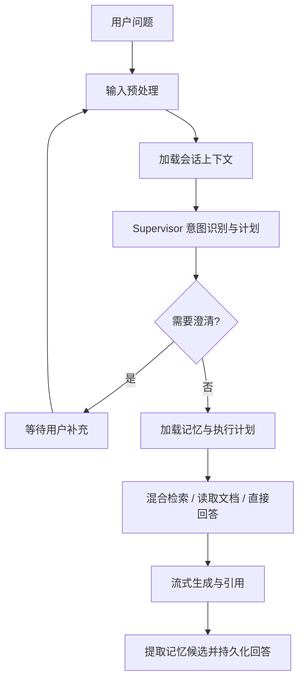

# OwnAgent

OwnAgent 是一个面向个人和团队知识库的对话式 Agent 服务。它以 LangGraph 编排每次 Agent run，支持会话上下文理解、知识检索、文档读取与比较、流式回答、澄清、人工审批和记忆管理。API、Agent、文档导入和记忆处理分别运行，由 PostgreSQL、Redis Streams 和 Outbox 协同完成可靠任务处理。

## Agent 能力

Supervisor 会先结合当前问题、最近会话消息和会话摘要判断意图、改写检索问题并生成受校验的执行计划。当前支持知识问答、文档摘要、文档比较、一般对话和用户偏好更新。涉及模糊指代且上下文不足时，Agent 可以暂停并请求用户澄清；澄清回复会恢复同一个 run。不同问题使用独立 run 和 LangGraph thread，会话关系通过持久化消息和摘要建立。



会话短期上下文默认使用最近 `4000` 个估算 tokens，最新消息优先；会话摘要独立于短期窗口，由 Memory Worker 以“已有摘要 + 新消息”的方式增量合并。长期记忆区分用户级和 Workspace 级，候选经过安全性和敏感度处理；低风险偏好可自动保存，需确认的候选由用户确认或拒绝。记忆用于个性化表达，不作为知识库事实证据。

知识问答默认采用混合召回：向量检索与关键词检索并行执行，合并候选后使用阿里云百炼 DashScope Reranker 重排。检索会遵守 Workspace/文档访问范围，并只使用当前激活的成功文档版本。答案以检索证据为依据并附带文档、版本和片段引用；证据不足时应明确说明。

文档支持 PDF、DOCX、Markdown 和纯文本导入、解析、分块、Embedding、详情预览和分块预览。文档版本追加保存；从详情页替换文件时必须显式指定目标文档。新版本解析成功后才激活，失败时旧版本继续可预览和检索。支持失败重试、重新解析、历史版本预览和手动激活历史版本。

## 架构

| 进程 | 职责 |
| --- | --- |
| API (`src/server.ts`) | 认证、Workspace/API、WebSocket、run 创建与控制、文档和记忆管理 |
| Agent Worker (`src/worker.ts`) | 消费 Agent run 与控制消息，运行 LangGraph，持久化事件并推送实时更新 |
| Document Worker (`src/document-worker.ts`) | 处理文档上传、解析、分块、向量化和版本激活 |
| Memory Worker (`src/memory-worker.ts`) | 更新会话摘要、记忆候选、记忆向量和会话标题 |
| PostgreSQL / Supabase | `ownagent` schema 中保存业务数据、run、事件、Outbox 和 LangGraph checkpoint |
| Redis Streams | 任务短期传输、Consumer Group、Pending 回收和死信队列 |

任务先写入 PostgreSQL 和 Outbox，再由事件驱动的 Dispatcher 发布到 Redis。PostgreSQL 是任务、run、事件和文档版本的持久化事实来源；Redis 不承担长期存储。Agent run 事件可通过 HTTP 按 sequence 补取，也可通过 WebSocket 实时接收。前端 WebSocket 不可用时，可通过事件轮询继续消费已有 run 事件。

数据存放在独立的 `ownagent` schema。后端使用 Supabase service-role 访问数据，并在业务查询中执行 Workspace 和用户权限校验。service-role、JWT、DashScope 和 Storage 密钥不得暴露给浏览器。

## 环境要求

- Node.js 20 或更高版本
- npm
- Docker Desktop 与 Docker Compose v2
- DeepSeek API（Agent Supervisor 和回答生成）
- 可访问的 OpenAI-compatible Embedding 服务
- 阿里云百炼 DashScope Reranker API

## 本地开发配置与启动

开发环境与生产环境完全隔离。开发电脑使用仓库内的 Supabase CLI、本地 Redis 和独立 Langfuse，API/Worker/前端在宿主机热更新；生产环境仍使用根目录统一 Compose。

```powershell
npm install
if (-not (Test-Path .env.development)) { Copy-Item .env.development.example .env.development }
notepad .env.development
npm run setup:dev
npm run start:dev
```

前端在同级项目单独启动：

```powershell
cd ..\ownagentweb
npm install
npm run dev
```

开发 API 是 `http://127.0.0.1:8787`，前端是 `http://127.0.0.1:5173`，Supabase Studio 是 `http://127.0.0.1:54323`，Langfuse 是 `http://127.0.0.1:3002`。详细边界和清理方式见 [docs/DEVELOPMENT.md](docs/DEVELOPMENT.md)。

生产配置和启动方式见下节；不要将生产 `.env` 复制为 `.env.development`。

生产部署使用根目录的单一 Docker Compose 项目。前端位于同级目录 `../ownagentweb`，由 Compose 构建为静态站点；项目包含 OwnAgent 的前端、API/Worker、Supabase 数据库、Auth、REST、Storage、Realtime、Edge Functions、Studio、Langfuse、Caddy 和 Cloudflare Tunnel。DeepSeek、DashScope 和远程 Embedding 仍然是外部 API。

```powershell
if (-not (Test-Path .env)) { Copy-Item .env.example .env }
notepad .env
# 填写 PUBLIC_BASE_URL、CLOUDFLARE_TUNNEL_TOKEN、ADMIN_EMAIL、ADMIN_PASSWORD 和模型密钥
npm run init:compose
```

先在 Cloudflare Tunnel Dashboard 将公网 hostname 的服务目标设为 `http://caddy:80`。`PUBLIC_BASE_URL` 使用该 hostname 的 HTTPS 地址。初始化脚本会生成新的 Supabase/Langfuse 基础设施密钥，清空本项目旧 Supabase、Langfuse 和 OwnAgent Redis 数据卷，启动全新 Compose 服务，依序执行 `supabase/migrations/` 的全部 SQL，并创建 `.env` 中指定的首位管理员。

初始化会删除旧数据且不会创建备份。运行前确认旧数据不再需要；脚本会要求输入 `DELETE OLD DATA` 才会继续。它只删除当前 Supabase CLI 项目、Langfuse 项目和 OwnAgent Compose 使用的明确卷名，不会删除 Docker 中其他 Supabase 项目的卷。不要使用 `docker compose down -v`。

停止服务：

```powershell
docker compose down
```

初始化完成后，API 使用 Compose 内部的 `kong`、`db` 和 `ownagent-redis` 地址；浏览器收到的 TUS 和 S3 multipart 上传 URL 使用 `SUPABASE_PUBLIC_URL`/`SUPABASE_S3_PUBLIC_ENDPOINT`。Caddy 将 `/api/*`、`/ws`、`/health/*` 转发到 OwnAgent，将 Supabase 的 `/auth/v1/*`、`/rest/v1/*`、`/graphql/v1`、`/storage/v1/*`、`/realtime/v1/*` 和 `/functions/v1/*` 转发到 Kong，其余页面路径转发到前端容器。Tunnel 只连接 Caddy，不直接暴露数据库、Redis 或 Storage 容器。

前端 Docker 构建上下文要求 `E:\project\ownagentweb` 与本仓库 `E:\project\ownagent` 保持同级。前端通过 `/api` 和 `/ws` 使用同一 hostname，因此 HTTPS 部署会自动使用安全 WebSocket。修改前端后，在本仓库运行 `docker compose up -d --build frontend caddy` 重新构建并加载。

Langfuse UI 仅在本机 `http://127.0.0.1:3001` 开放；Supabase Studio 仅在本机 `http://127.0.0.1:54323` 开放。日常备份：

```powershell
npm run backup:compose
```

备份目录包含 `supabase.sql` 和 `supabase-storage.tar.gz`。恢复时先停止 Compose，再将 SQL 导入目标 PostgreSQL；将 Storage 归档解压到一个新的空卷后，再以该卷启动服务。全新初始化后，这些备份不会自动恢复。

## Agent 与检索配置

常用配置位于 `.env.example`：

| 配置 | 默认值 | 作用 |
| --- | --- | --- |
| `DEEPSEEK_MODEL` | `deepseek-chat` | Agent 生成与结构化模型调用 |
| `SUPERVISOR_MODEL` | 跟随应用默认模型 | Supervisor 模型覆盖 |
| `EMBEDDING_MODEL` | `qwen3.7-text-embedding-flash` | 文档、查询与记忆向量模型 |
| `RERANK_MODEL` | `qwen3.7-text-rerank` | DashScope 文本重排模型 |
| `RETRIEVAL_MODE` | `hybrid` | `hybrid` 或仅 `vector` 候选召回 |
| `CONVERSATION_RECENT_TOKENS` | `4000` | Supervisor 最近会话消息窗口 |
| `CONVERSATION_SUMMARY_THRESHOLD` | `30` | 首次生成会话摘要的消息数门槛 |
| `CONVERSATION_SUMMARY_INPUT_TOKENS` | `6000` | 每次摘要合并输入预算 |
| `CONVERSATION_SUMMARY_OUTPUT_TOKENS` | `1600` | 会话摘要输出预算 |
| `AGENT_MAX_EVIDENCE` | `8` | Agent 使用的检索证据上限 |
| `AGENT_MAX_CONTEXT_TOKENS` | `12000` | 答案证据上下文预算 |
| `MEMORY_AUTO_SAVE_LOW_RISK` | `true` | 是否自动保存符合条件的低风险记忆 |
| `MEMORY_CONFIRM_SENSITIVE` | `true` | 是否要求确认敏感记忆候选 |

Embedding 与 Reranker 配置错误不会阻止认证 API 启动，但会影响检索能力。`GET /health/ready` 会报告 Supabase、Redis、Embedding、DashScope Reranker、DeepSeek 和 Langfuse 的状态，并在可用时返回 Redis 与 Outbox 积压指标。

## HTTP API

所有 Workspace 业务接口均在 `/api/workspaces/:workspaceId` 下，并根据成员角色执行权限校验。

| 能力 | 路径 |
| --- | --- |
| 登录、刷新、登出、当前用户 | `/api/auth/login`、`/api/auth/refresh`、`/api/auth/logout`、`/api/auth/me` |
| Workspace 与成员 | `/api/workspaces`、`/api/workspaces/:workspaceId/members`、`/api/workspaces/:workspaceId/invites` |
| 会话与消息 | `/api/workspaces/:workspaceId/conversations`、`/api/workspaces/:workspaceId/conversations/:conversationId` |
| 创建、读取、取消 Agent run | `/api/workspaces/:workspaceId/runs`、`/api/workspaces/:workspaceId/runs/:runId`、`/api/workspaces/:workspaceId/runs/:runId/cancel` |
| Run 事件与恢复/控制 | `/api/workspaces/:workspaceId/runs/:runId/events`、`.../follow-up`、`.../approve`、`.../reject`、`.../interrupt` |
| 文档、版本和搜索 | `/api/workspaces/:workspaceId/documents`、`.../versions`、`.../replace`、`/api/workspaces/:workspaceId/search` |
| 用户/Workspace 记忆 | `/api/memories?workspaceId=:workspaceId` |

创建 Agent run 时必须提供 `X-Idempotency-Key`，请求体包括 `question`，并可选传入 `conversationId`。创建成功返回 `202`。可通过 `GET .../events?afterSequence=N` 续取事件。WebSocket 位于 `/ws`，登录后用 HttpOnly Cookie 完成握手认证；客户端可订阅 run、启动 run、提交澄清回复、审批或中断任务。WebSocket 与 HTTP 事件使用同一 sequence，便于去重和断线恢复。

文档上传使用可续传流程；新建上传创建新文档，替换上传必须调用指定 `documentId` 的 replace 路由。文件名和 fingerprint 不决定更新目标。服务端对完整文件计算 SHA-256；相同内容不会重复创建版本，跨文档重复内容会返回冲突。只有状态为 `ready` 的激活版本参与检索。

## 观测、构建与测试

Langfuse 链路追踪可通过 `LANGFUSE_TRACING` 配置。生产环境建议保持 `LANGFUSE_CAPTURE_CONTENT=false` 和 `LANGFUSE_DEBUG_CONTENT=false`，以避免采集完整提示词、证据或回答正文。

```powershell
npm run build
npm test
```

- `GET /health/live`：仅检查 API 进程是否存活。
- `GET /health/ready`：检查服务依赖状态、Redis 队列和 Outbox 指标。
- `npm run build`：TypeScript 构建。
- `npm test`：运行 Vitest 测试集。

## 安全与部署提示

- `SUPABASE_SERVICE_ROLE_KEY`、`AUTH_JWT_SECRET`、`DASHSCOPE_API_KEY`、数据库和对象存储密钥只配置在服务端。
- 生产环境启用 HTTPS，并将 `AUTH_COOKIE_SECURE=true`；配置准确的 `WEB_ORIGIN` 和 Cookie SameSite 策略。
- 首次全新部署前确认旧数据已不再需要；`npm run init:compose` 会在确认后删除指定旧卷并执行全部 OwnAgent migrations。
- Redis 使用 `noeviction` 以避免任务静默丢失。Outbox 中未发布任务会在 Dispatcher 启动或数据库重连时重新扫描。
